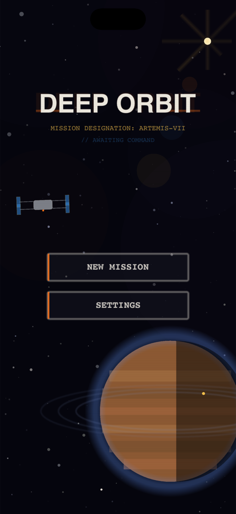
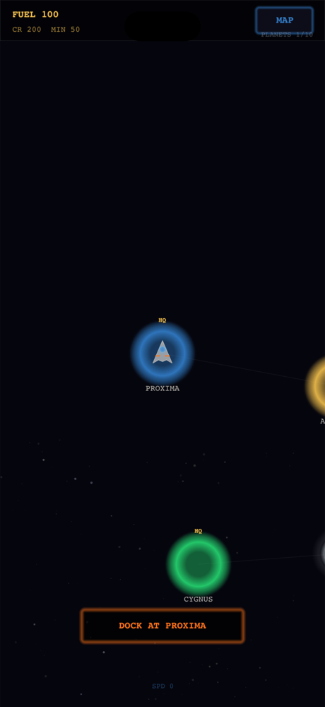
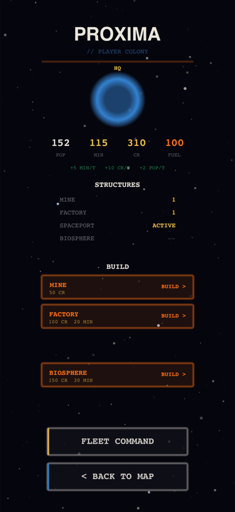

# Deep Orbit

A space strategy game for iPhone that mixes galaxy-scale empire building with top-down arcade
combat, inspired by *Star Reach* (1994). Built in SpriteKit with no third-party dependencies.

  
  
  

## The game

- **Galaxy map**: a procedurally generated galaxy; fly between planets on a fuel budget
- **Planets**: build mines, factories, spaceports and biospheres to grow an economy
- **Combat**: wave-based arcade encounters decide who holds a planet
- **Rival factions**: three AI races expand and compete for the same galaxy
- **Fleets**: ships you build join the fight
- **Campaign**: win and lose states, with save and load

Status: **1.0 complete**. Roadmap and milestones are in [`docs/roadmap.md`](docs/roadmap.md).

## Structure

Each screen is an `SKScene`, split into focused extensions:

| Area | Files |
|---|---|
| Galaxy | `GalaxyGenerator`, `GalaxyMapScene` (+ `HUD`, `Navigation`) |
| Combat | `GameplayScene` (+ `Combat`, `Input`, `Player`, `Spawning`, `HUD`), `CombatContext` |
| Free roam | `FreeRoamScene` (+ `Controls`, `HUD`) |
| Strategy | `PlanetDetailScene`, `FleetManagerScene`, `AIController`, `FactionData` |
| State | `GameState`, `SaveManager`, `GameSettings` |
| Look and feel | `Theme`, `BackgroundBuilder`, `GameFeedback` |

## Running it

Open `DeepOrbit.xcodeproj` and run the **DeepOrbit** scheme on an iOS simulator or device. Tests use Swift Testing:
`xcodebuild test -project DeepOrbit.xcodeproj -scheme DeepOrbit -destination 'platform=iOS Simulator,name=iPhone 18 Pro'`.

## Licence

[MIT](LICENSE)
